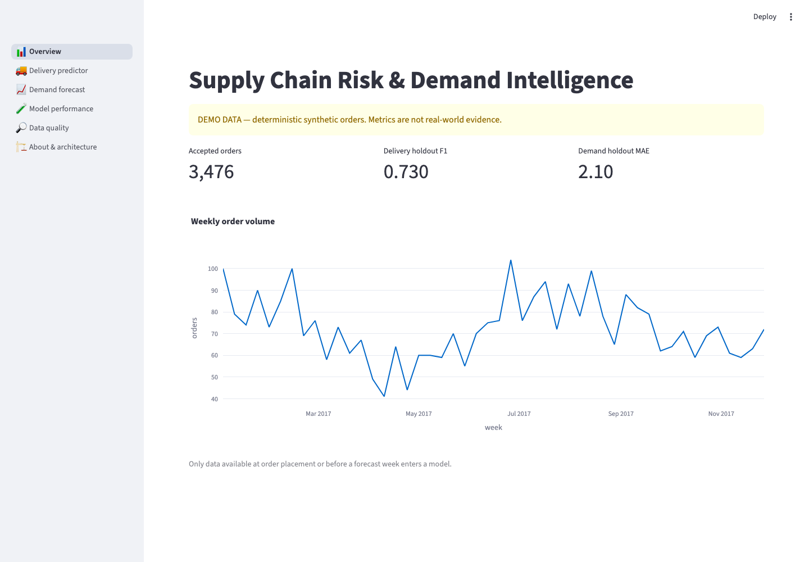

# Supply-chain risk and demand intelligence

Python 3.12+ platform for an **order-time delivery-lateness proxy**
and **next-week category/state order forecasting**. It provides a
deterministic demo workflow and optional ingestion of Olist's historical
Brazilian e-commerce CSVs. These are not live supply-chain risk
measurements or inventory recommendations. Demo and historical Olist
results below are labeled separately.



*Demo dashboard screenshot; the displayed metrics are synthetic, not Olist results.*

## Local workflow

Install Python 3.12, then from the project root:

```sh
cp .env.example .env
make install
make run-all
make run-api
# In a separate terminal:
make run-app
```

Open <http://localhost:8000/docs> and <http://localhost:8501>. The
default source is `demo`. `make install` creates a local `.venv`.
For manual CLI calls, use `.venv/bin/python -m src.cli ...`.
Set `PLATFORM_DATA_DIR` and
`PLATFORM_ARTIFACT_DIR` to control the generated `data/` and `artifacts/`
locations. Demo data and its metrics are illustrative, **not real-world
validation**. Scores change when the pipeline is rerun on other inputs.
Keep downloaded input and generated outputs out of version control.

The dashboard reads the API only (`PLATFORM_API_URL`, default
`http://localhost:8000`). The API provides `GET /health`, `/models`,
`/metrics`, `/quality`, and `/history`, plus prediction endpoints. The
CLI also accepts `ingest`, `preprocess`, `train-delay`, `train-demand`,
and `evaluate` as separate stages; `run-all` executes them in order.
Each stage fails when its input is missing. Output is ignored by Git:
`data/platform.duckdb` contains curated orders, weekly demand and
summaries; `artifacts/` contains `quality.json`, `metrics.json`, model
metadata and `.joblib` pipelines. Don't load model artifacts from
untrusted sources.

Example predictions after starting the API:

```sh
curl -X POST http://localhost:8000/predict/delivery-risk \
  -H 'Content-Type: application/json' \
  -d '{"purchased_at":"2017-10-02T12:00:00","estimated_delivery":"2017-10-18T12:00:00","customer_state":"SP","category":"electronics","item_count":2,"total_price":120}'
curl -X POST http://localhost:8000/predict/demand \
  -H 'Content-Type: application/json' \
  -d '{"category":"electronics","customer_state":"SP"}'
```

**Observed demo-only run (Python 3.12, 2026-10-18):** 3,476 synthetic
orders accepted, none rejected. Held-out delivery F1 0.730 and ROC-AUC
0.850 (majority baseline F1 0); next-week demand MAE 2.104 orders
versus 2.031 for the prior-week baseline. These figures are *not* Olist
measurements or evidence of real-world performance. The demand model
does **not** beat its baseline on the demo holdout.

## Docker Compose workflow

```sh
docker compose up --build
```

Compose first runs one-shot `init`; only if that succeeds does it start the
API at <http://localhost:8000> and dashboard at
<http://localhost:8501>. The API and dashboard see shared `data/` and
`artifacts/` volumes read-only. The API must use a read-only DuckDB
connection; initialization is the only writer. To refresh, stop serving
containers before rerunning initialization and restart them afterward.
`docker compose down -v` deletes the generated named volumes.

## Olist source

Manually download the [official Olist Brazilian E-Commerce Public Dataset
on Kaggle](https://www.kaggle.com/datasets/olistbr/brazilian-ecommerce)
and extract these files into an input directory:

- `olist_orders_dataset.csv`
- `olist_order_items_dataset.csv`
- `olist_customers_dataset.csv`
- `olist_products_dataset.csv`
- `product_category_name_translation.csv`

For local use, run
`.venv/bin/python -m src.cli run-all --source olist --input-dir /path/to/olist`.
For Compose, put the CSVs in `./input` and run
`PLATFORM_SOURCE=olist docker compose up --build`. The dataset is mounted
read-only, excluded from Docker build context, and not downloaded by CI.
Consult the source's license and terms before using or sharing its data.
The Kaggle listing identifies the license as **CC BY-NC-SA 4.0**; this
repository does not include the dataset. Keep original CSVs under ignored
`input/` and generated outputs under ignored `data/` and `artifacts/`.

**Observed Olist run (Python 3.12, 2026-10-18; original CSVs downloaded
locally, not redistributed):** 98,666 of 99,441 orders passed cleaning.
The held-out delivery classifier achieved F1 **0.098**, precision
**0.057**, recall **0.351**, and ROC-AUC **0.674**; late orders comprised
only **3.6%** of the test period. This is a weak classifier with many
false positives and is **not suitable for operational decisions**.
Held-out weekly demand MAE was **0.648** orders, compared with **0.667**
for the prior-week baseline. These are retrospective results on
historical Brazilian marketplace data, not prospective or US-market
validation; see the [model cards](docs/model-cards.md) for selection
bias, possible estimate revisions, and temporal limitations.

## Quality checks and design

With the lockfile (compiled with
`uv pip compile pyproject.toml --extra dev --universal --output-file requirements.lock`)
installed, run `ruff check .`, `pytest -q`, and
`docker build -t supply-chain-risk-demand-intelligence:ci .`.
GitHub Actions installs with `pip install -r requirements.lock` followed by
`pip install --no-deps -e .` and runs these checks on pushes and pull requests.

- [Architecture and deployment](docs/architecture.md)
- [Input and derived data dictionary](docs/data-dictionary.md)
- [Model contracts and limitations](docs/model-cards.md)
- [Design decisions](docs/decisions.md)
