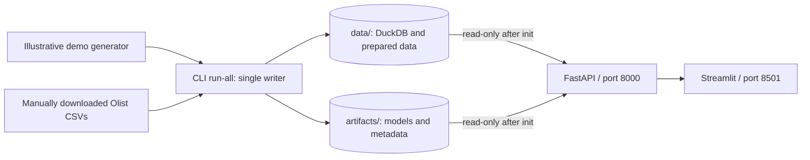

# Architecture

The deployment targets Python 3.12 or newer. Initialization is a finite batch
step; the API and dashboard serve its completed outputs.

## Execution and storage

- `python -m src.cli run-all` initializes demo output. For real input, run
  `python -m src.cli run-all --source olist --input-dir /path/to/olist`.
  `PLATFORM_SOURCE=demo` is the default. Ingestion persists its source
  metadata; preprocessing reads that persisted source rather than relying
  on a later command's source flag.
- `PLATFORM_DATA_DIR` and `PLATFORM_ARTIFACT_DIR` select output directories;
  Compose sets them to `/app/data` and `/app/artifacts`. These are shared
  named volumes, writable by `init` and mounted read-only in `api` and `app`.
- `docker compose up --build` builds the image, runs `init` to successful
  completion, and then starts `uvicorn src.api:app` and
  `streamlit run src/dashboard.py`. The dashboard calls the API only, using
  `PLATFORM_API_URL=http://api:8000` inside Compose. The API exposes
  `GET /health`, `/models`, `/metrics`, `/quality`, and `/history` in addition
  to prediction routes. Compose health checks wait for the API before
  starting the dashboard.
- Only `init` writes to DuckDB. The API must open its database read-only and
  must not retrain, ingest, or mutate it; the dashboard should query the API.
  For a refresh, stop the serving containers, rerun initialization, then
  restart them so no writer overlaps readers or cached model handles.
  Concurrent Compose projects must not share the same writable volume.
- The `./input` bind mount is read-only and is used for Olist mode. It is
  excluded from the image. No download or dataset credentials are required
  for demo mode.

## Temporal modeling boundary

The late-delivery classifier predicts, at order purchase time, whether a
delivered order's recorded delivery calendar date exceeds its recorded estimated
delivery calendar date. The canonical `delivered` boolean comes from Olist's
`order_status`, but is an eligibility filter, never a feature. Current
features include purchase calendar, customer state, primary item category,
item count, total item price, and promised days
(estimated delivery minus purchase). Actual delivery time and later order
status are never features. Olist's recorded estimate and item information
must be confirmed to have been available at purchase before these scores
can be described as prospectively leakage-safe.

The demand task forecasts next calendar week's **order count** by primary
category and customer state from completed prior weeks. An order with
multiple items contributes once to the category of its highest-priced item
(ties broken by product ID). Features for forecast week `W` may use weeks
strictly before `W`; any category mapping that changed over time needs a
historical snapshot or an explicit limitation. Training, validation, and
testing must follow time order. If late-delivery
outcomes are used as historical features, they must already have been known
at each prediction cutoff. See [model cards](model-cards.md).

## Scope and limitations

Olist is a historical Brazilian e-commerce dataset, not a live supply-chain
telemetry feed. Delivery-lateness and demand are proxies, not verified
disruption causes or inventory recommendations. Demo metrics must never be
presented as real-world performance.
